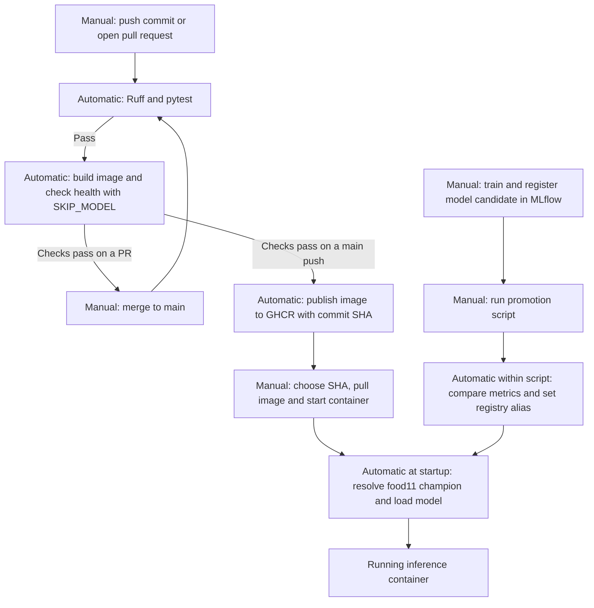

# Lab 5 — CI/CD with GitHub Actions

Questions 1–11 are in [LAB5_ANSWERS.md](../LAB5_ANSWERS.md).

## Question 12 — From Git push to a running container



The image tag chooses the code revision. The `champion` alias chooses the model version each time inference starts. Publishing an image leaves the deployment step to the operator.

## Local verification

The frozen dependency sync, Ruff, and all six pytest tests passed. The updated source ran in a Linux container built on the existing Lab 3 runtime image. `/health` returned HTTP 200 with `SKIP_MODEL=1` and with the real champion loaded. With the champion loaded, uploading the fixture returned `Meat` with `52.7%` confidence, matching the earlier Lab 3 check. The full Dockerfile build from a cold dependency cache remains to be verified in GitHub Actions. To inspect the saved model versions locally, start the Compose MLflow service with `docker compose up -d mlflow`.

## GitHub steps after the local work

1. Stage and commit the Lab 5 files from the repository root. If `main` is already protected, use a feature branch and pull request for the initial change.

   ```powershell
   git add LAB5_ANSWERS.md .github/workflows/ci.yml tests/ src/food11/data.py src/food11/serve.py src/food11/train.py src/food11/validate_data.py src/food11/promote.py pyproject.toml uv.lock lab/lab5.md
   git diff --cached --check
   git commit -m "Add CI/CD pipeline, tests, data contract and promotion gate"
   ```

2. Push the commit. Watch **Actions → ci** until `test`, `smoke`, and, on a push to `main`, `push` finish. Before enabling branch protection, run `git commit --allow-empty -m "ci"` and then `git push origin main`. Record the observed timings for Question 6. If `main` is already protected, use a branch to compare the test and smoke runs.
3. In GitHub Packages, find the container image tag matching the full SHA of a successful `main` push. Pull it with `docker pull ghcr.io/maroun222/mlops-lab-1:<full-commit-sha>` after replacing the placeholder. If the package is private, authenticate to GHCR with an account that has package read access. [GitHub Container Registry documentation](https://docs.github.com/en/packages/working-with-a-github-packages-registry/working-with-the-container-registry)
4. In the repository's branch protection settings, require a pull request for `main` and require the `test` and `smoke` checks. Apply the rule to administrators too if testing as the repository owner. [GitHub branch protection documentation](https://docs.github.com/en/repositories/configuring-branches-and-merges-in-your-repository/managing-protected-branches/about-protected-branches)
5. Create a new branch and deliberately change one expected category in `tests/test_data.py`. Commit and push that branch, open a pull request, and record the failure and merge state for Question 9. Restore the correct expected value, commit and push the fix, and merge after the checks pass. Include the completed observations in a PR if the rule is already active.
